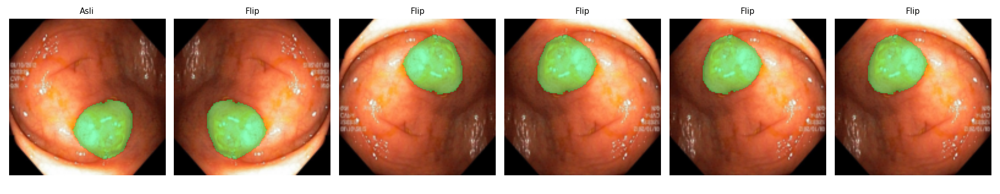
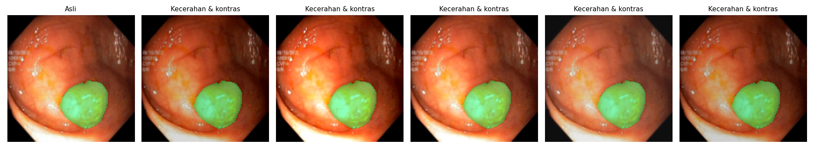
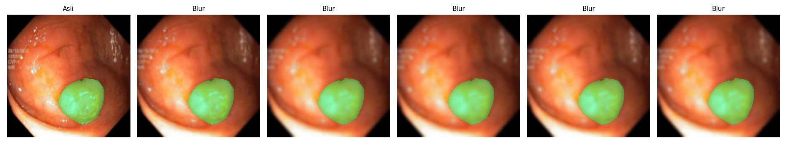
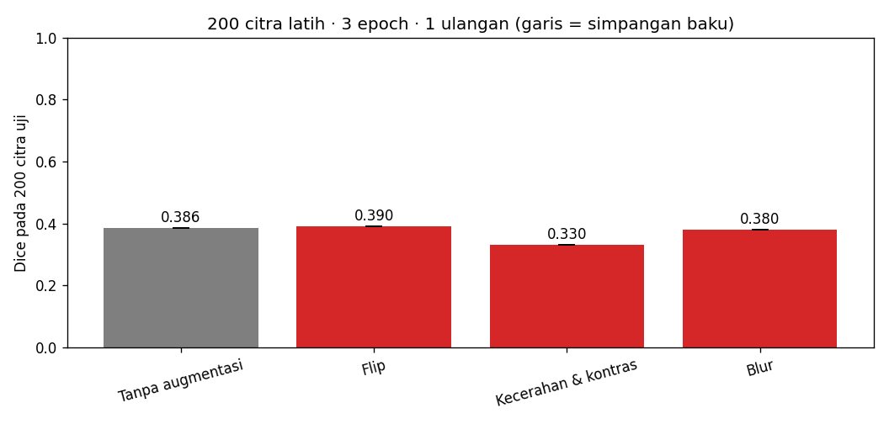
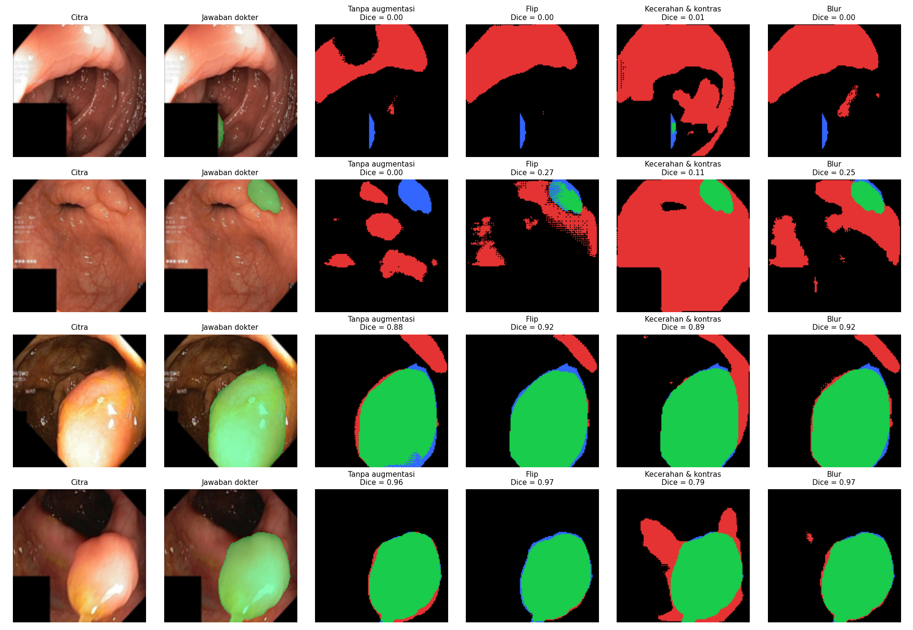

# Segmentasi Polip pada Citra Kolonoskopi dengan U-Net

**Tugas P10 — Kecerdasan Buatan (BM25-41204), Teknik Biomedis ITERA**

## Anggota kelompok

| Nama | NIM | Username GitHub | Kontribusi utama |
|---|---|---|---|
| Ahmad Rifqi | 123430060 | Amdrifqi23 | menyiapkan project eksperimen, menjalankan project eksperimen, membuat skenario dan README. |


## 1. Pertanyaan

Augmentasi apa yang membantu U-Net menemukan polip pada citra kolonoskopi, dan augmentasi apa yang tidak? Kenapa?

## 2. Data & pengaturan

<!-- Isi dari Bagian 2 notebook. Pastikan CEPAT = False untuk hasil akhir. -->

- Dataset: Kvasir-SEG (1000 citra kolonoskopi + mask polip), diperkecil ke 128 × 128 piksel.
- Data uji: 200 citra (tetap). Data latih: 200 citra per ulangan.
- Model: U-Net mini (±0,5 juta parameter), 50 epoch, 3 ulangan per skenario.
- Dijalankan di: Google Colab T4.

## 3. Skenario augmentasi & hipotesis

<!-- Tulis bagian ini SEBELUM menjalankan eksperimen. Commit dulu, baru jalankan.
     Alasan klinis = kenapa variasi ini mungkin (atau tidak mungkin) terjadi pada kolonoskopi sungguhan. -->

| Skenario | Augmentasi (kode) | Alasan klinis | Hipotesis: Dice naik/turun/sama? |
|---|---|---|---|
| Tanpa augmentasi | — | Pembanding | — |
| Flip | `v2.Compose([v2.RandomHorizontalFlip(), v2.RandomVerticalFlip()])` | Orientasi kamera kolonoskopi dapat berubah. Flip digunakan untuk melatih model mengenali polip pada orientasi berbeda. | Naik, dibandingkan tanpa augmentasi, karena model diharapkan tidak bergantung pada orientasi polip. |
| Kecerahan & kontras |  `v2.ColorJitter(brightness=0.3, contrast=0.3)` | Tampilan pencahayaan citra dapat bervariasi. Augmentasi ini meniru variasi terang dan kontras. | Naik dibandingkan tanpa augmentasi, karena model diharapkan lebih tahan terhadap variasi pencahayaan. |
| Blur| `"Blur": v2.GaussianBlur(kernel_size=5, sigma=(0.1, 2.0))` |hasil gambar buram dalam klasifikasintya. | Naik, dibandingkan tanpa augmentasi, karena model diharapkan tidak bergantung pada orientasi polip. |


Contoh augmentasi yang dicoba:




<!-- Ganti nama file sesuai skenario kalian (lihat isi folder hasil/). -->

## 4. Hasil

<!-- Tempel isi hasil/ringkasan.md di sini. -->

| Skenario | Dice (rata-rata ± sb) | IoU (rata-rata ± sb) | Dice tiap ulangan |
|---|---|---|---|
| Tanpa augmentasi | 0.386 ± 0.000 | 0.267 ± 0.000 | 0.386 |
| Flip | 0.390 ± 0.000 | 0.272 ± 0.000 | 0.390 |
| Kecerahan & kontras | 0.330 ± 0.000 | 0.219 ± 0.000 | 0.330 |
| Blur | 0.380 ± 0.000 | 0.261 ± 0.000 | 0.380 |


https://colab.research.google.com/drive/1em1_WpgoTg9zoINC3Lq1PixVhgJqnyLR?usp=sharing

## 5. Analisis peta kesalahan
Analisis kualitatif melalui peta kesalahan menunjukkan adanya perbedaan performa yang kontras antara citra dengan polip berukuran besar dan polip berukuran kecil. Pada kasus polip besar dan menonjol (Baris 3 dan 4), seluruh skenario mampu memprediksi area polip (True Positive berwarna hijau) dengan akurat, di mana augmentasi Flip dan Blur menghasilkan batas segmentasi paling presisi dengan skor Dice mencapai 0,92 dan 0,97 serta area False Positive (merah) yang sangat minimal. Sebaliknya, pada kasus polip berukuran kecil atau datar yang disertai pantulan cahaya terang pada mukosa (Baris 1 dan 2), model cenderung gagal mendeteksi polip (False Negative berwarna biru) dan salah mengenali lipatan mukosa terang sebagai polip (False Positive berwarna merah).   Selain itu, peta kesalahan mengungkap bahwa penurunan skor pada augmentasi kecerahan dan kontras disebabkan oleh fenomena over-segmentation yang masif. Hal ini tampak jelas pada Baris 2 dan Baris 4, di mana area False Positive berwarna merah melebar secara signifikan di sekitar polip maupun jaringan mukosa normal sehingga menurunkan skor Dice masing-masing menjadi 0,11 dan 0,79. Sementara itu, augmentasi Flip terbukti paling efektif dalam menekan kesalahan False Positive di area tepi objek sekaligus meningkatkan kemampuan deteksi awal pada polip kecil di sudut citra (Baris 2 dengan Dice 0,27 dibandingkan tanpa augmentasi sebesar 0,00).


<!-- Hijau = benar, merah = false positive, biru = false negative.
     Pertanyaan pemandu: Polip seperti apa yang sering terlewat (kecil? datar? warna mirip dinding usus?)
     Apa yang sering dikira polip padahal bukan? Apakah augmentasi memperbaiki kasus sulit? -->
   

## 6. Pembahasan & kesimpulan

<!-- Bandingkan hasil dengan hipotesis di Bagian 3. Hipotesis yang ternyata salah tetap bernilai,
     asalkan dijelaskan kenapa. Perbedaan kecil (lebih kecil dari simpangan baku) belum tentu berarti. -->


untuk hasil akhirnya :
| Skenario | Dice (rata-rata ± sb) | IoU (rata-rata ± sb) | Dice tiap ulangan |
|---|---|---|---|
| Tanpa augmentasi | 0.386 ± 0.000 | 0.267 ± 0.000 | 0.386 |
| Flip | 0.390 ± 0.000 | 0.272 ± 0.000 | 0.390 |
| Kecerahan & kontras | 0.330 ± 0.000 | 0.219 ± 0.000 | 0.330 |
| Blur | 0.380 ± 0.000 | 0.261 ± 0.000 | 0.380 |

Berdasarkan hasil pengujian, augmentasi Flip menghasilkan nilai Dice tertinggi sebesar 0,390 dan IoU sebesar 0,272 dibandingkan tanpa augmentasi, augmentasi Blur, maupun augmentasi kecerahan dan kontras. Hal ini menunjukkan bahwa augmentasi Flip membantu model mengenali variasi orientasi objek pada citra dengan lebih baik.

Sementara itu, augmentasi Blur memperoleh nilai Dice sebesar 0,380 dan IoU sebesar 0,261, sedangkan augmentasi kecerahan dan kontras menghasilkan nilai terendah dengan Dice sebesar 0,330 dan IoU sebesar 0,219. Kedua skenario tersebut berada di bawah performa tanpa augmentasi yang mencatat nilai Dice 0,386 dan IoU 0,267. Hal ini menunjukkan bahwa pengaburan detail citra (blur) serta perubahan intensitas pencahayaan dan kontras pada pengaturan yang digunakan justru mengurangi ketajaman fitur yang dibutuhkan model untuk melakukan segmentasi secara optimal.

Dengan demikian, hipotesis bahwa augmentasi Flip dapat meningkatkan performa segmentasi didukung oleh arah peningkatan pada hasil pengujian, sedangkan augmentasi Blur serta kecerahan dan kontras belum menunjukkan peningkatan. Namun, karena selisih nilai Dice antara augmentasi Flip dan tanpa augmentasi tergolong sangat kecil (0,004) serta pengujian baru dilakukan dalam satu kali ulangan (simpangan baku 0,000), peningkatan tersebut belum dapat dinyatakan signifikan secara statistik.


## 7. Pembagian kerja

<!-- Siapa mengerjakan apa. Penilaian proses kerja dilihat dari riwayat commit tiap anggota. -->

| Nama | NIM | Username GitHub | Kontribusi utama |
|---|---|---|---|
| Ahmad Rifqi | 123430060 | amdrifqi23 | Menyiapkan lingkungan eksperimen, menjalankan model U-Net, melakukan pengujian, dan mengumpulkan hasil eksperimen. |

## 8. Penggunaan AI

saya menggunakan agent di notebook untuk memperbaiki bagian "path".

## Cara menjalankan ulang

```bash
uv sync
uv run jupyter lab segmentasi_polip.ipynb
```

Atau buka notebook di Google Colab (Runtime → Change runtime type → T4 GPU).

## Referensi

- Jha, D., dkk. (2020). Kvasir-SEG: A Segmented Polyp Dataset. *MultiMedia Modeling (MMM 2020)*, 451–462.
- Ronneberger, O., Fischer, P., & Brox, T. (2015). U-Net: Convolutional Networks for Biomedical Image Segmentation. *MICCAI*. arXiv:1505.04597.
- M. F. Ahamed et al., “Automated colorectal polyps detection from endoscopic images using MultiResUNet framework with attention guided segmentation,” Human-Centric Intelligent Systems, vol. 4, pp. 299–315, 2024, doi: 10.1007/s44230-024-00067-1.
- Eelbode, T., Bertels, J., Berman, M., Vandermeulen, D., Maes, F., Bisschops, R., & Blaschko, M. B. (2020). Optimization for Medical Image Segmentation: Theory and Practice When Evaluating With Dice Score or Jaccard Index. *IEEE Transactions on Medical Imaging*, 39(11), 3679–3690. https://doi.org/10.1109/TMI.2020.3002417.
